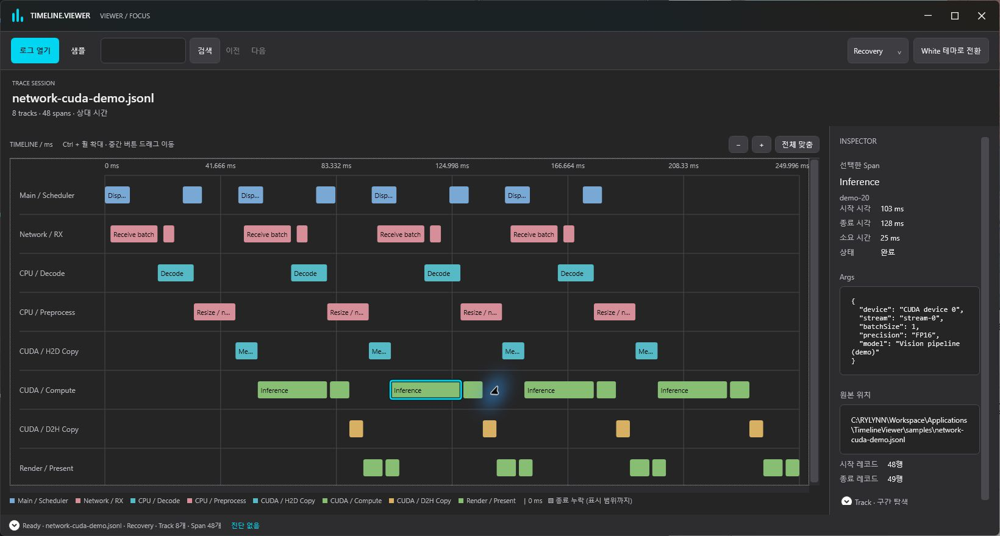
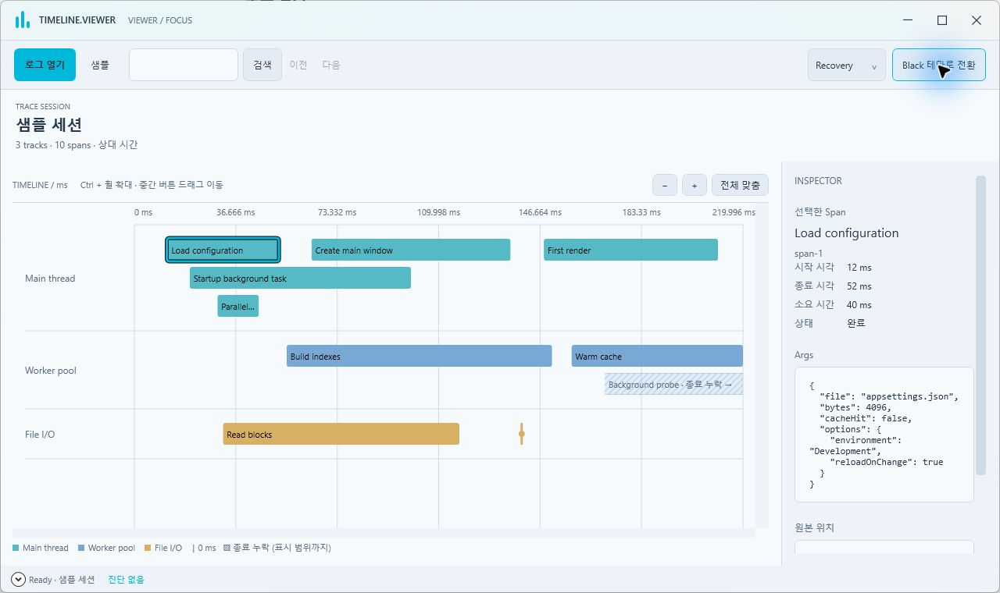
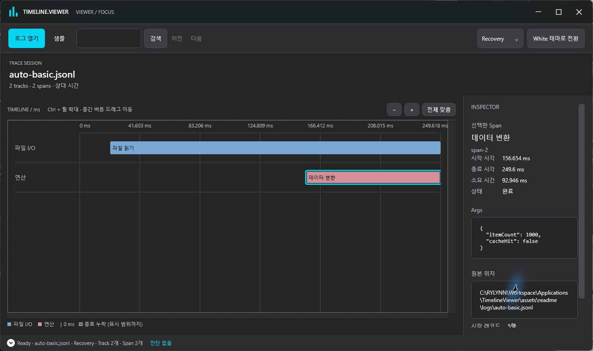
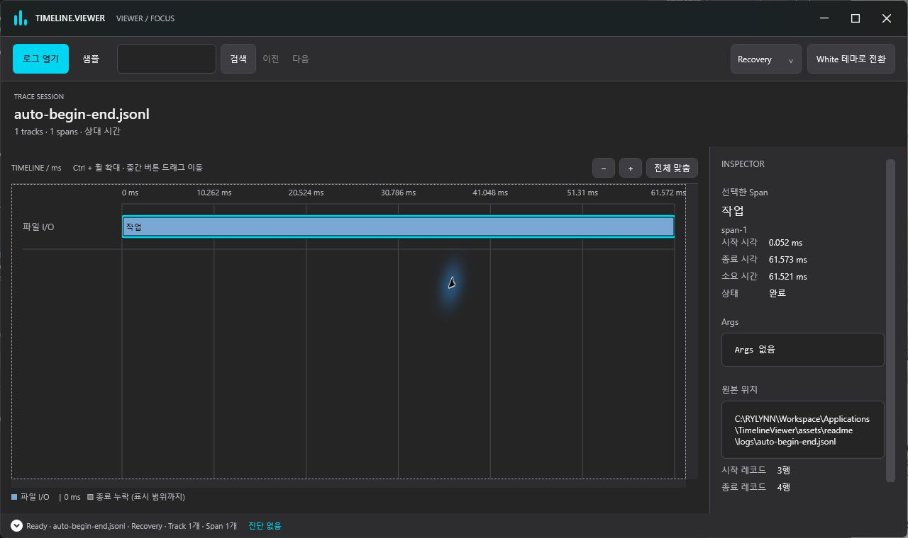
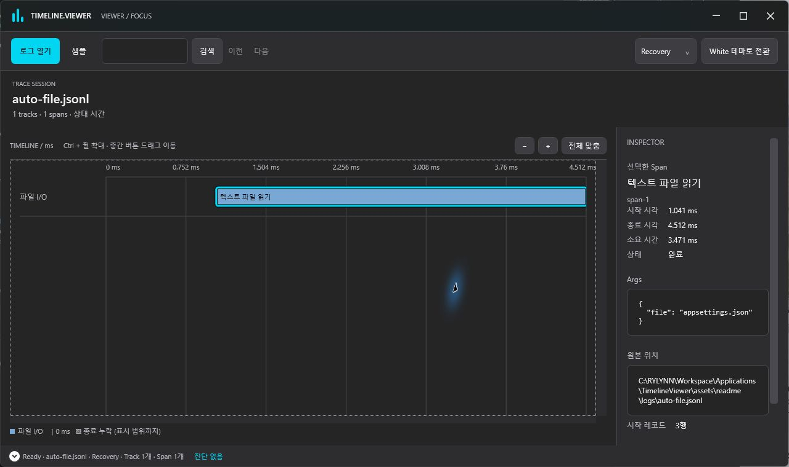
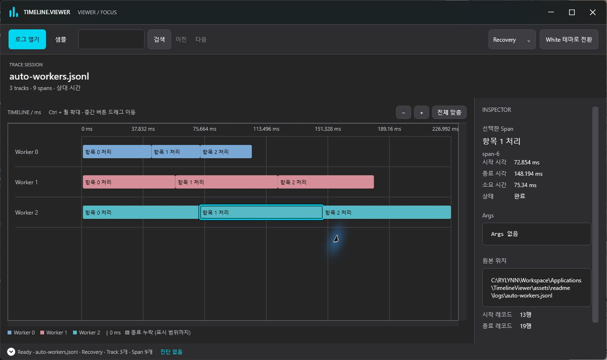
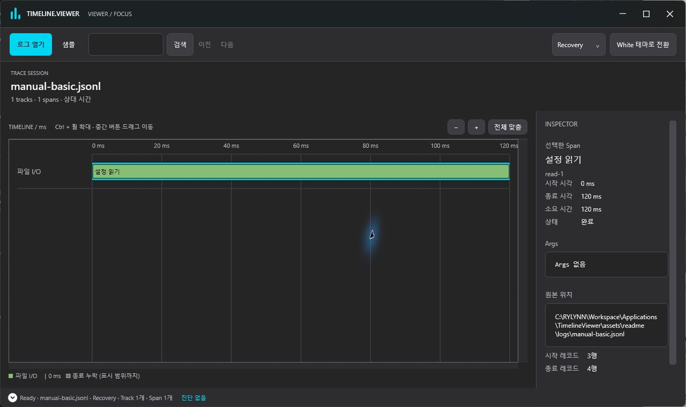
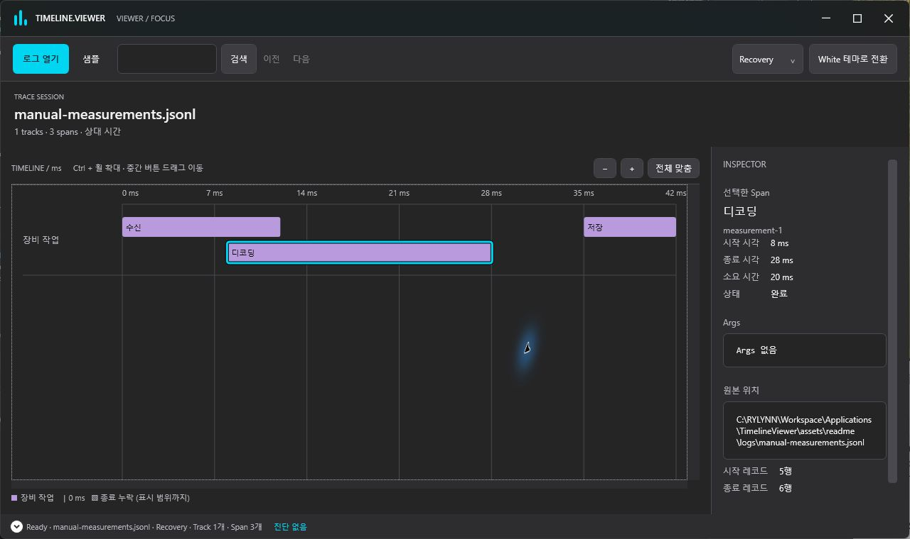
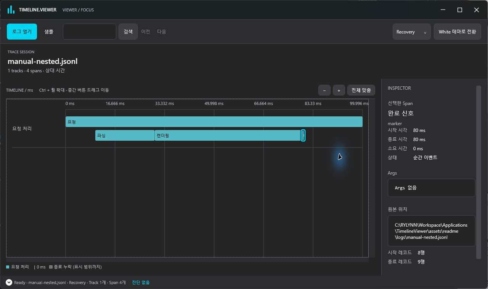

# Timeline.Viewer

.NET 애플리케이션의 실행 구간을 **JSONL 로그로 기록**하고, **WPF 타임라인에서 탐색**하는 도구입니다.
파일 I/O, 연산, 렌더링 등을 Track으로 구분하고 각 작업의 시작·종료 시각과 소요 시간을 확인할 수 있습니다.



*네트워크 수신 → CPU 디코딩·전처리 → CUDA H2D 전송·추론·D2H 전송 → 렌더링 흐름을 8개 Track, 48개 구간으로 표현한 실제 Viewer 화면입니다. 선택한 추론 구간의 시간과 Args도 함께 확인할 수 있습니다. 캡처용 가상 로그이며 실제 CUDA 프로파일링 결과는 아닙니다.*

[빌드 및 실행](#빌드-및-실행) · [DLL 연결](#1-다른-앱에서-dll-참조하기) · [자동 기록](#2-실행-시간을-자동으로-기록하기) · [수동 기록](#3-writer를-직접-생성해-jsonl-기록하기) · [사용 매뉴얼](#4-timelineviewer-사용-매뉴얼)

<details>
<summary>White 테마 화면 보기</summary>



</details>

```text
애플리케이션 → Timeline.Tracing / Timeline.IO → .jsonl 파일
                                                   ↓
                                            Timeline.Viewer
                                      타임라인 · Inspector · 진단
```

## 주요 기능

- `TimelineTracer`: 작업 시간 자동 측정, 부모·자식 구간, Args 기록, 큐 기반 백그라운드 저장
- `JsonlTraceWriter`: 시작·종료 시각을 직접 지정하는 JSONL 레코드 기록
- Track별 타임라인, 가로·세로 스크롤, 드래그 이동, 포인터 기준 확대·축소
- Span 선택과 Inspector, 이름·ID·Track 검색 및 결과 순회
- Recovery / Strict 읽기 모드, 진단 목록과 원본 줄 미리보기
- 비동기 파일 열기, 처리 단계 표시, 취소 가능한 대기 창
- Black / White 테마, Windows Mica·Acrylic 재질, 창 배치와 테마 복원

## 빌드 및 실행

소스 빌드에는 **Windows와 .NET 9 SDK**가 필요합니다. Viewer는 `net9.0-windows` WPF 앱이며, 로그 기록 라이브러리는 `net9.0`을 대상으로 합니다.

저장소 루트에서 실행합니다.

```powershell
dotnet build TimelineViewer.sln -c Release
dotnet run --project Timeline.Viewer/Timeline.Viewer.csproj -c Release
```

앱을 실행한 뒤 **샘플 살펴보기** 또는 상단 **샘플** 버튼을 누르면 별도 파일 없이 타임라인 조작을 시험할 수 있습니다.

Viewer를 런타임 포함 Windows x64 폴더로 배포하려면 다음 명령을 사용합니다.

```powershell
dotnet publish Timeline.Viewer/Timeline.Viewer.csproj -c Release -r win-x64 --self-contained true -o publish/Timeline.Viewer
```

`publish/Timeline.Viewer` 폴더 전체를 배포하고 그 안의 `Timeline.Viewer.exe`를 실행합니다.

## 1. 다른 앱에서 DLL 참조하기

먼저 로그 기록 라이브러리를 빌드합니다.

```powershell
dotnet build Timeline.Tracing/Timeline.Tracing.csproj -c Release
```

`Timeline.Tracing/bin/Release/net9.0/`에 생성된 다음 DLL을 사용할 앱의 `lib` 폴더에 복사합니다.

| DLL | 역할 |
| --- | --- |
| `Timeline.Format.dll` | 헤더, Track, Begin, End 등 레코드 정의 |
| `Timeline.IO.dll` | JSONL 직렬화와 파일 읽기·쓰기 |
| `Timeline.Tracing.dll` | 시간 측정, Scope, 백그라운드 기록 |

사용할 앱의 `.csproj`에 참조를 추가합니다. 아래 예제는 프로젝트 파일 옆에 `lib` 폴더가 있는 경우입니다.

```xml
<ItemGroup>
  <Reference Include="Timeline.Format">
    <HintPath>lib\Timeline.Format.dll</HintPath>
    <Private>true</Private>
  </Reference>
  <Reference Include="Timeline.IO">
    <HintPath>lib\Timeline.IO.dll</HintPath>
    <Private>true</Private>
  </Reference>
  <Reference Include="Timeline.Tracing">
    <HintPath>lib\Timeline.Tracing.dll</HintPath>
    <Private>true</Private>
  </Reference>
</ItemGroup>
```

Visual Studio의 **참조 추가 → 찾아보기**로 DLL을 선택해도 됩니다. 아래 예제의 기준은 .NET 9 앱이며, .NET Framework WPF 앱에는 이 DLL을 그대로 참조할 수 없습니다.

소스를 함께 관리한다면 DLL 복사 대신 `Timeline.Tracing.csproj`를 `ProjectReference`로 참조할 수도 있습니다. Writer만 직접 사용할 경우에는 `Timeline.Format.dll`, `Timeline.IO.dll` 두 개만 필요합니다.

## 상황별 기록 방식 선택

| 상황 | 사용할 API | 예제 |
| --- | --- | --- |
| 함수·파일 읽기의 실행 시간을 측정 | `BeginScope` | 자동 A: 비동기 파일 읽기 |
| 여러 Worker가 동시에 실행 | 하나의 Tracer + Worker별 Track | 자동 B: 병렬 작업 |
| 시작과 끝을 직접 제어하거나 취소 처리 | `Begin` / `End` + `finally` | 자동 C: 취소 가능한 작업 |
| 이미 측정된 시작·소요 시간이 있음 | `JsonlTraceWriter` | 수동 A: 측정 결과 일괄 변환 |
| 부모·자식 또는 중첩 구간을 표현 | `ParentId`, 고유 Span ID | 수동 B: 계층과 순간 이벤트 |

**자동/수동은 시간 측정의 차이입니다.** Tracer는 호출 시각을 자동 측정하고, Writer는 전달받은 시각을 그대로 기록합니다. Tracer의 `Begin` / `End`도 시간 자체는 자동 측정합니다. 앱의 모든 함수를 자동으로 추적하는 방식은 아니며, 측정할 구간에 계측 코드를 넣어야 합니다.

### 예제 결과를 직접 열어보기

각 코드 아래의 JSONL 파일과 캡처는 해당 예제를 실행한 결과입니다. GitHub에서 파일 링크를 연 뒤 **Download raw file**로 저장하고, Viewer의 **로그 열기**로 열어보세요. 저장소를 복제했다면 `assets/readme/logs` 폴더의 파일을 바로 열 수 있습니다.

자동 예제의 시각은 한 번의 실제 실행에서 측정한 값이며 PC·스케줄링·파일 캐시에 따라 달라집니다. Task.Delay의 지정값과 실제 소요 시간은 같지 않을 수 있습니다. 수동 예제의 상대 시각은 코드에 지정된 값입니다. 기본 예제의 저장 파일명만 문서용 고정 이름으로 바꿨고, Begin/End 및 메서드 예제는 각각 별도 Tracer/Writer로 실행했습니다. 옵션 설정 코드는 자체 작업 구간을 만들지 않으므로 별도 캡처를 두지 않았습니다.

## 2. 실행 시간을 자동으로 기록하기

일반적인 애플리케이션 계측에는 `TimelineTracer`를 사용합니다. 내부에서 Writer를 생성하고, 작업 시간을 세션 시작 기준 마이크로초로 측정합니다.

다음 코드는 .NET 9 콘솔 프로젝트의 `Program.cs`에서 실행할 수 있는 예제입니다.

```csharp
using System;
using System.Collections.Generic;
using System.IO;
using System.Text.Json;
using System.Threading.Tasks;
using Timeline.Tracing;

Directory.CreateDirectory("logs");
string filePath = Path.GetFullPath(
    Path.Combine("logs", $"session-{Guid.NewGuid():N}.jsonl"));

await using (var tracer = await TimelineTracer.CreateAsync(filePath))
{
    var ioTrack = tracer.CreateTrack("파일 I/O");
    var computeTrack = tracer.CreateTrack("연산");

    using (var load = tracer.BeginScope("파일 읽기", ioTrack))
    {
        // 실제 앱에서는 여기에 파일 읽기 코드를 넣습니다.
        await Task.Delay(120);

        var spanArgs = new Dictionary<string, JsonElement>
        {
            ["itemCount"] = JsonSerializer.SerializeToElement(1000),
            ["cacheHit"] = JsonSerializer.SerializeToElement(false)
        };

        using (tracer.BeginScope(
            "데이터 변환", computeTrack, parent: load.Handle, args: spanArgs))
        {
            await Task.Delay(80);
        }
    }

    await tracer.FlushAsync();
} // 남은 큐를 처리하고 sessionEnd를 기록한 뒤 Writer를 닫습니다.

Console.WriteLine($"저장 완료: {filePath}");
```

**실행 결과** · [auto-basic.jsonl 열기 / 다운로드](assets/readme/logs/auto-basic.jsonl)

파일 읽기 안에서 데이터 변환이 실행됩니다. 선택한 데이터 변환의 Args에 itemCount와 cacheHit가 표시됩니다.



<details>
<summary>이 화면에 사용한 JSONL 로그 보기</summary>

문자열의 Unicode 이스케이프는 읽기 쉽게 풀어 표시했습니다. 레코드와 시각은 연결된 파일과 같습니다.

```jsonl
{"type":"header","format":"timeline","version":1,"timeUnit":"us","originUtc":"2026-11-11T01:14:42.2438356+00:00"}
{"type":"track","id":"track-1","name":"파일 I/O"}
{"type":"track","id":"track-2","name":"연산"}
{"type":"begin","id":"span-1","track":"track-1","name":"파일 읽기","time":21019}
{"type":"begin","id":"span-2","track":"track-2","name":"데이터 변환","time":156654,"parent":"span-1","args":{"itemCount":1000,"cacheHit":false}}
{"type":"end","id":"span-2","time":249600}
{"type":"end","id":"span-1","time":249619}
{"type":"sessionEnd","time":251879,"droppedRecordCount":0}
```

</details>

- **Track**: 작업을 분류하는 행입니다. 예: 파일 I/O, 렌더링, Worker 1.
- **Span**: 시작과 종료를 가진 작업 구간입니다.
- **BeginScope**: 호출 시 Begin을 기록하고 `using` 블록을 나갈 때 End를 기록합니다. `await`를 포함한 구간에도 사용할 수 있습니다.
- **Parent**: 부모 Span을 명시적으로 지정합니다. `using` 중첩만으로 부모 관계가 자동 설정되지는 않습니다.
- **Args**: 추가 정보입니다. Viewer의 Inspector에서 확인할 수 있습니다.

Scope를 쓰기 어려운 작업은 직접 시작·종료할 수 있습니다.

```csharp
var span = tracer.Begin("작업", ioTrack);
try
{
    await Task.Delay(50);
}
finally
{
    tracer.End(span);
}
```

**실행 결과** · [auto-begin-end.jsonl 열기 / 다운로드](assets/readme/logs/auto-begin-end.jsonl)

Begin/End로 직접 감싼 작업입니다. Task.Delay(50)의 실제 측정 구간은 이 실행에서 약 61.521ms입니다.



<details>
<summary>이 화면에 사용한 JSONL 로그 보기</summary>

문자열의 Unicode 이스케이프는 읽기 쉽게 풀어 표시했습니다. 레코드와 시각은 연결된 파일과 같습니다.

```jsonl
{"type":"header","format":"timeline","version":1,"timeUnit":"us","originUtc":"2026-11-11T01:14:42.5096997+00:00"}
{"type":"track","id":"track-1","name":"파일 I/O"}
{"type":"begin","id":"span-1","track":"track-1","name":"작업","time":52}
{"type":"end","id":"span-1","time":61573}
{"type":"sessionEnd","time":61580,"droppedRecordCount":0}
```

</details>

위 코드는 앞 예제의 `tracer`와 `ioTrack`이 살아 있는 블록 안에 넣습니다. 정상 종료와 예외 경로 모두에서 End가 기록되도록 `finally` 또는 Scope를 사용하세요.

### 상황별 자동 기록 예제

아래 메서드는 클래스 안에 넣거나 콘솔 `Program.cs`의 로컬 함수로 사용할 수 있습니다. 앞의 기본 예제와 같은 `using`에 `using System.Threading;`을 추가하세요. **Tracer는 호출하는 쪽에서 생성·종료**하고, 모든 비동기 작업을 기다린 후 종료합니다.

#### 자동 A: 비동기 파일 읽기와 입력 정보 기록

설정이나 데이터를 읽는 데 걸린 시간을 확인할 때 사용합니다. 파일 경로 대신 파일 이름을 Args로 남기는 예제입니다.

```csharp
static async Task<string> ReadTextAsync(
    ITracer tracer, TraceTrackHandle track,
    string path, CancellationToken cancellationToken)
{
    var metadata = new Dictionary<string, JsonElement>
    {
        ["file"] = JsonSerializer.SerializeToElement(Path.GetFileName(path))
    };

    using (tracer.BeginScope("텍스트 파일 읽기", track, args: metadata))
    {
        return await File.ReadAllTextAsync(path, cancellationToken);
    }
}
```

**실행 결과** · [auto-file.jsonl 열기 / 다운로드](assets/readme/logs/auto-file.jsonl)

appsettings.json을 실제로 읽은 결과입니다. 선택한 구간은 약 3.471ms이며 Args에 파일 이름이 표시됩니다.



<details>
<summary>이 화면에 사용한 JSONL 로그 보기</summary>

문자열의 Unicode 이스케이프는 읽기 쉽게 풀어 표시했습니다. 레코드와 시각은 연결된 파일과 같습니다.

```jsonl
{"type":"header","format":"timeline","version":1,"timeUnit":"us","originUtc":"2026-11-11T01:14:42.572741+00:00"}
{"type":"track","id":"track-1","name":"파일 I/O"}
{"type":"begin","id":"span-1","track":"track-1","name":"텍스트 파일 읽기","time":1041,"args":{"file":"appsettings.json"}}
{"type":"end","id":"span-1","time":4512}
{"type":"sessionEnd","time":4519,"droppedRecordCount":0}
```

</details>

호출: `await ReadTextAsync(tracer, ioTrack, "appsettings.json", CancellationToken.None);`
입력 파일은 미리 준비합니다. `return`이나 예외로 메서드를 빠져나가도 Scope가 종료됩니다. 비동기 대기 시간도 구간에 포함됩니다.

#### 자동 B: 여러 Worker의 병렬 작업 비교

하나의 Tracer를 공유하고 Track으로 작업을 분류합니다. Track은 실제 OS 스레드 ID가 아니라 사용자가 정하는 논리적 그룹입니다.

```csharp
static async Task RunWorkersAsync(TimelineTracer tracer)
{
    var tasks = new List<Task>();
    for (int worker = 0; worker < 3; worker++)
    {
        int workerIndex = worker;
        var track = tracer.CreateTrack($"Worker {workerIndex}");
        tasks.Add(Task.Run(async () =>
        {
            for (int item = 0; item < 3; item++)
            {
                using (tracer.BeginScope($"항목 {item} 처리", track))
                {
                    // 실제 작업 코드로 교체합니다.
                    await Task.Delay(30 + workerIndex * 20);
                }
            }
        }));
    }

    await Task.WhenAll(tasks);
}
```

**실행 결과** · [auto-workers.jsonl 열기 / 다운로드](assets/readme/logs/auto-workers.jsonl)

Worker 0·1·2가 각각 3개 항목을 처리합니다. 총 9개 Span의 겹침과 Worker별 처리 시간 차이를 볼 수 있습니다.



<details>
<summary>이 화면에 사용한 JSONL 로그 보기</summary>

문자열의 Unicode 이스케이프는 읽기 쉽게 풀어 표시했습니다. 레코드와 시각은 연결된 파일과 같습니다.

```jsonl
{"type":"header","format":"timeline","version":1,"timeUnit":"us","originUtc":"2026-11-11T01:14:42.5776277+00:00"}
{"type":"track","id":"track-1","name":"Worker 0"}
{"type":"track","id":"track-2","name":"Worker 1"}
{"type":"track","id":"track-3","name":"Worker 2"}
{"type":"begin","id":"span-1","track":"track-1","name":"항목 0 처리","time":734}
{"type":"begin","id":"span-2","track":"track-3","name":"항목 0 처리","time":745}
{"type":"begin","id":"span-3","track":"track-2","name":"항목 0 처리","time":749}
{"type":"end","id":"span-1","time":42874}
{"type":"begin","id":"span-4","track":"track-1","name":"항목 1 처리","time":42885}
{"type":"end","id":"span-3","time":57644}
{"type":"begin","id":"span-5","track":"track-2","name":"항목 1 처리","time":57654}
{"type":"end","id":"span-2","time":72848}
{"type":"begin","id":"span-6","track":"track-3","name":"항목 1 처리","time":72854}
{"type":"end","id":"span-4","time":72863}
{"type":"begin","id":"span-7","track":"track-1","name":"항목 2 처리","time":72868}
{"type":"end","id":"span-7","time":104661}
{"type":"end","id":"span-5","time":120611}
{"type":"begin","id":"span-8","track":"track-2","name":"항목 2 처리","time":120615}
{"type":"end","id":"span-6","time":148194}
{"type":"begin","id":"span-9","track":"track-3","name":"항목 2 처리","time":148201}
{"type":"end","id":"span-8","time":179699}
{"type":"end","id":"span-9","time":226994}
{"type":"sessionEnd","time":227043,"droppedRecordCount":0}
```

</details>

호출: `await RunWorkersAsync(tracer);`
Viewer에서 Worker별 구간의 겹침과 소요 시간을 비교할 수 있습니다. 이 예제의 지연은 실행 흐름을 보여주기 위한 것으로 CPU 성능 측정 예제가 아닙니다.

#### 자동 C: 취소·예외 경로에서도 종료 기록하기

Scope 대신 핸들을 직접 관리해야 할 때의 패턴입니다. `End`를 성공 경로에만 두면 취소나 예외가 발생했을 때 종료 기록이 빠집니다.

```csharp
static async Task RunCancellableAsync(
    ITracer tracer, TraceTrackHandle track, CancellationToken cancellationToken)
{
    var span = tracer.Begin("취소 가능한 처리", track);
    try
    {
        await Task.Delay(500, cancellationToken);
    }
    finally
    {
        tracer.End(span);
    }
}
```

**실행 결과** · [auto-cancel.jsonl 열기 / 다운로드](assets/readme/logs/auto-cancel.jsonl)

호출부에서 CancelAfter(100)으로 취소를 요청하고 OperationCanceledException을 처리했습니다. 약 108.524ms 후 finally에서 End가 기록되어 완료로 표시됩니다. 업무 성공을 의미하지는 않습니다.


<details>
<summary>이 화면에 사용한 JSONL 로그 보기</summary>

문자열의 Unicode 이스케이프는 읽기 쉽게 풀어 표시했습니다. 레코드와 시각은 연결된 파일과 같습니다.

```jsonl
{"type":"header","format":"timeline","version":1,"timeUnit":"us","originUtc":"2026-11-11T01:14:42.8051642+00:00"}
{"type":"track","id":"track-1","name":"취소 요청"}
{"type":"begin","id":"span-1","track":"track-1","name":"취소 가능한 처리","time":467}
{"type":"end","id":"span-1","time":108991}
{"type":"sessionEnd","time":109083,"droppedRecordCount":0}
```

</details>

호출하는 쪽에서 `CancellationTokenSource`의 토큰을 전달하고 `OperationCanceledException`을 처리합니다. 종료 기록은 **구간이 끝났다는 뜻**입니다. Viewer의 완료 상태가 업무 성공을 뜻하지는 않으며, 현재 End API는 성공·실패 상태나 결과 Args를 받지 않습니다. 기록 중인 앱의 업무 오류 처리는 별도로 유지하세요.

### 기록 옵션과 종료 처리

```csharp
var options = new TimelineTracerOptions
{
    QueueCapacity = 8192,
    FlushInterval = TimeSpan.FromSeconds(1)
};

// filePath는 아직 존재하지 않는 새 파일 경로여야 합니다.
await using var tracer = await TimelineTracer.CreateAsync(filePath, options);
```

- 기본 큐 용량은 **8,192개**, 자동 Flush 주기는 **1초**입니다.
- 큐가 가득 차면 Begin/End 레코드가 누락될 수 있습니다. 누락 수는 종료 레코드의 `droppedRecordCount`에 기록됩니다. Track 등록은 큐가 가득 차면 예외를 발생시킵니다.
- `FlushAsync()`는 앞서 접수한 기록을 처리하고 버퍼를 비웁니다. 세션을 종료하지는 않습니다.
- 종료 시 `DisposeAsync()`를 기다려야 남은 기록과 종료 레코드가 저장됩니다. `await using`을 사용하면 이를 자동으로 호출합니다.
- 모든 작업의 Scope/End 처리를 마친 후 Tracer를 종료하세요. 프로세스 강제 종료 시에는 일부 기록이나 종료 레코드가 남지 않을 수 있습니다.
- 파일은 **새로 생성**합니다. 기존 파일 덮어쓰기·이어 쓰기는 지원하지 않으며, 상위 폴더는 호출하는 앱에서 만들어야 합니다.

## 3. Writer를 직접 생성해 JSONL 기록하기

이미 측정한 시간이 있거나 다른 시스템의 이벤트를 변환할 때는 `JsonlTraceWriter`를 직접 사용할 수 있습니다.
아래는 앞의 Tracer 예제와 별개로 실행하는 완전한 예제입니다.

```csharp
using System;
using System.IO;
using System.Threading.Tasks;
using Timeline.Format;
using Timeline.IO;

Directory.CreateDirectory("logs");
string filePath = Path.GetFullPath(
    Path.Combine("logs", $"manual-{Guid.NewGuid():N}.jsonl"));

await using (var writer = new JsonlTraceWriter(filePath))
{
    await writer.WriteAsync(new TraceHeaderRecord
    {
        OriginUtc = DateTimeOffset.UtcNow
    });

    await writer.WriteAsync(new TraceTrackRecord
    {
        Id = "io",
        Name = "파일 I/O"
    });

    await writer.WriteAsync(new TraceBeginRecord
    {
        Id = "read-1",
        TrackId = "io",
        Name = "설정 읽기",
        TimeUs = 0
    });

    await writer.WriteAsync(new TraceEndRecord
    {
        Id = "read-1",
        TimeUs = 120_000
    });

    await writer.WriteAsync(new TraceSessionEndRecord
    {
        TimeUs = 120_000,
        DroppedRecordCount = 0
    });

    await writer.FlushAsync();
}

Console.WriteLine($"저장 완료: {filePath}");
```

**실행 결과** · [manual-basic.jsonl 열기 / 다운로드](assets/readme/logs/manual-basic.jsonl)

코드에서 지정한 0–120ms 구간이 그대로 표시됩니다. Inspector의 소요 시간도 정확히 120ms입니다.



<details>
<summary>이 화면에 사용한 JSONL 로그 보기</summary>

문자열의 Unicode 이스케이프는 읽기 쉽게 풀어 표시했습니다. 레코드와 시각은 연결된 파일과 같습니다.

```jsonl
{"type":"header","format":"timeline","version":1,"timeUnit":"us","originUtc":"2026-11-11T01:14:42.5091274+00:00"}
{"type":"track","id":"io","name":"파일 I/O"}
{"type":"begin","id":"read-1","track":"io","name":"설정 읽기","time":0}
{"type":"end","id":"read-1","time":120000}
{"type":"sessionEnd","time":120000,"droppedRecordCount":0}
```

</details>

이 예제는 **120ms 구간을 가진 데이터**를 기록합니다. Writer 자체가 시간을 측정하거나 120ms를 기다리는 것은 아닙니다.

직접 기록할 때는 다음 규칙을 지킵니다.

1. 첫 레코드는 Header이며 한 번만 기록합니다.
2. Track을 등록하고, Begin의 `TrackId`로 연결합니다.
3. Begin/End는 같은 Span ID를 사용합니다. 서로 다른 Span에는 고유 ID를 사용합니다.
4. `TimeUs`는 세션 시작 기준 **마이크로초(µs)**이며 종료 시각은 시작 시각 이상이어야 합니다.
5. 마지막에 SessionEnd를 기록합니다. Writer의 Dispose는 종료 레코드를 자동 생성하지 않습니다.
6. 동일 Writer의 호출은 순차적으로 `await`합니다. 여러 작업의 기록을 큐로 모아 저장하려면 Tracer를 사용합니다.

### 상황별 수동 기록 예제

아래 두 메서드는 각각 **새 Writer**에 호출하는 독립 예제입니다. 메서드 안에서 Header부터 SessionEnd까지 기록하므로 앞의 기본 예제에서 이미 레코드를 쓴 Writer에 이어 호출하지 마세요.

공통 준비: `using System;`, `using System.IO;`, `using System.Threading.Tasks;`, `using Timeline.Format;`, `using Timeline.IO;`.
상위 폴더를 만든 뒤 `await using var writer = new JsonlTraceWriter(새파일경로);`로 생성하고 메서드를 호출합니다.

#### 수동 A: 외부 장비·기존 측정 결과를 타임라인으로 변환

이미 확보한 시작 시각과 소요 시간을 µs로 변환합니다. 입력 순서대로 서로 다른 ID를 부여하고 마지막 종료 시각을 세션 끝으로 사용합니다.

```csharp
static async Task ExportMeasurementsAsync(JsonlTraceWriter writer)
{
    // 예시 입력: 세션 시작 기준 밀리초 값입니다.
    var measurements = new[]
    {
        (Name: "수신", StartMs: 0L, DurationMs: 12L),
        (Name: "디코딩", StartMs: 8L, DurationMs: 20L),
        (Name: "저장", StartMs: 35L, DurationMs: 7L)
    };

    await writer.WriteAsync(new TraceHeaderRecord
    {
        // 실제 변환에서는 측정 세션의 UTC 시작 시각을 넣습니다.
        OriginUtc = new DateTimeOffset(2026, 11, 11, 0, 0, 0, TimeSpan.Zero)
    });
    await writer.WriteAsync(new TraceTrackRecord { Id = "device", Name = "장비 작업" });

    long sessionEndUs = 0;
    for (int i = 0; i < measurements.Length; i++)
    {
        var measurement = measurements[i];
        long startUs = checked(measurement.StartMs * 1000);
        long endUs = checked(startUs + measurement.DurationMs * 1000);
        string id = $"measurement-{i}";

        await writer.WriteAsync(new TraceBeginRecord
        {
            Id = id, TrackId = "device", Name = measurement.Name, TimeUs = startUs
        });
        await writer.WriteAsync(new TraceEndRecord { Id = id, TimeUs = endUs });
        sessionEndUs = Math.Max(sessionEndUs, endUs);
    }

    await writer.WriteAsync(new TraceSessionEndRecord
    {
        TimeUs = sessionEndUs, DroppedRecordCount = 0
    });
    await writer.FlushAsync();
}
```

**실행 결과** · [manual-measurements.jsonl 열기 / 다운로드](assets/readme/logs/manual-measurements.jsonl)

수신(0–12ms)과 디코딩(8–28ms)이 겹쳐 서로 다른 Lane에 표시됩니다. 선택한 디코딩은 20ms이고 저장은 35–42ms입니다.



<details>
<summary>이 화면에 사용한 JSONL 로그 보기</summary>

문자열의 Unicode 이스케이프는 읽기 쉽게 풀어 표시했습니다. 레코드와 시각은 연결된 파일과 같습니다.

```jsonl
{"type":"header","format":"timeline","version":1,"timeUnit":"us","originUtc":"2026-11-11T00:00:00+00:00"}
{"type":"track","id":"device","name":"장비 작업"}
{"type":"begin","id":"measurement-0","track":"device","name":"수신","time":0}
{"type":"end","id":"measurement-0","time":12000}
{"type":"begin","id":"measurement-1","track":"device","name":"디코딩","time":8000}
{"type":"end","id":"measurement-1","time":28000}
{"type":"begin","id":"measurement-2","track":"device","name":"저장","time":35000}
{"type":"end","id":"measurement-2","time":42000}
{"type":"sessionEnd","time":42000,"droppedRecordCount":0}
```

</details>

호출: `await ExportMeasurementsAsync(writer);`
수신(0–12ms)과 디코딩(8–28ms)은 시간이 겹치므로 같은 Track 안에서 다른 Lane에 배치됩니다. 파일 줄 순서와 시간 순서가 항상 같을 필요는 없으며 Begin/End ID를 정확히 연결해야 합니다.

입력이 UTC 시각이면 `(timestamp - originUtc).Ticks / 10`으로 상대 µs를 얻을 수 있습니다. 서로 다른 장비의 시계는 사전에 동기화해야 하며, 음수 시간·종료 역전·범위 초과는 변환 전에 검증하세요.

#### 수동 B: 부모·자식 구간과 순간 이벤트

한 요청 안에서 파싱과 렌더링이 실행되는 상황입니다. 부모 관계는 `ParentId`로 지정하고, 기간이 없는 이벤트는 같은 시각의 Begin/End 쌍으로 표현합니다.

```csharp
static async Task WriteNestedSessionAsync(JsonlTraceWriter writer)
{
    await writer.WriteAsync(new TraceHeaderRecord { OriginUtc = DateTimeOffset.UtcNow });
    await writer.WriteAsync(new TraceTrackRecord { Id = "main", Name = "요청 처리" });
    await writer.WriteAsync(new TraceBeginRecord
    {
        Id = "request", TrackId = "main", Name = "요청", TimeUs = 0
    });
    await writer.WriteAsync(new TraceBeginRecord
    {
        Id = "parse", TrackId = "main", ParentId = "request",
        Name = "파싱", TimeUs = 10_000
    });
    await writer.WriteAsync(new TraceEndRecord { Id = "parse", TimeUs = 30_000 });
    await writer.WriteAsync(new TraceBeginRecord
    {
        Id = "render", TrackId = "main", ParentId = "request",
        Name = "렌더링", TimeUs = 30_000
    });
    await writer.WriteAsync(new TraceEndRecord { Id = "render", TimeUs = 80_000 });
    await writer.WriteAsync(new TraceBeginRecord
    {
        Id = "marker", TrackId = "main", ParentId = "request",
        Name = "완료 신호", TimeUs = 80_000
    });
    await writer.WriteAsync(new TraceEndRecord { Id = "marker", TimeUs = 80_000 });
    await writer.WriteAsync(new TraceEndRecord { Id = "request", TimeUs = 100_000 });
    await writer.WriteAsync(new TraceSessionEndRecord
    {
        TimeUs = 100_000, DroppedRecordCount = 0
    });
    await writer.FlushAsync();
}
```

**실행 결과** · [manual-nested.jsonl 열기 / 다운로드](assets/readme/logs/manual-nested.jsonl)

100ms 요청 안에 파싱·렌더링이 배치됩니다. 80ms의 완료 신호를 선택하면 시작·종료가 모두 80ms, 소요 시간 0ms인 순간 이벤트로 표시됩니다.



<details>
<summary>이 화면에 사용한 JSONL 로그 보기</summary>

문자열의 Unicode 이스케이프는 읽기 쉽게 풀어 표시했습니다. 레코드와 시각은 연결된 파일과 같습니다.

```jsonl
{"type":"header","format":"timeline","version":1,"timeUnit":"us","originUtc":"2026-11-11T01:14:42.9162499+00:00"}
{"type":"track","id":"main","name":"요청 처리"}
{"type":"begin","id":"request","track":"main","name":"요청","time":0}
{"type":"begin","id":"parse","track":"main","name":"파싱","time":10000,"parent":"request"}
{"type":"end","id":"parse","time":30000}
{"type":"begin","id":"render","track":"main","name":"렌더링","time":30000,"parent":"request"}
{"type":"end","id":"render","time":80000}
{"type":"begin","id":"marker","track":"main","name":"완료 신호","time":80000,"parent":"request"}
{"type":"end","id":"marker","time":80000}
{"type":"end","id":"request","time":100000}
{"type":"sessionEnd","time":100000,"droppedRecordCount":0}
```

</details>

호출: `await WriteNestedSessionAsync(writer);`
요청은 100ms, 파싱은 20ms, 렌더링은 50ms이며 완료 신호는 0ms 표시로 나타납니다. `ParentId`는 관계를 기록하지만 화면의 Lane 배치는 구간 겹침에 의해 결정됩니다.

### 파일 형식 예시

JSONL은 한 줄에 JSON 객체 하나를 저장합니다. 일반 JSON 배열이나 임의의 JSONL 로그가 아니라 아래 Timeline 레코드 형식을 사용합니다.

```jsonl
{"type":"header","format":"timeline","version":1,"timeUnit":"us","originUtc":"2026-11-11T00:00:00+00:00"}
{"type":"track","id":"io","name":"파일 I/O"}
{"type":"begin","id":"read-1","track":"io","name":"설정 읽기","time":0}
{"type":"end","id":"read-1","time":120000}
{"type":"sessionEnd","time":120000,"droppedRecordCount":0}
```

C#의 `TimeUs`, `TrackId`, `ParentId`는 파일에서 각각 `time`, `track`, `parent`로 저장됩니다. 기록 단위는 µs이며 Viewer의 시간 눈금은 ms로 표시됩니다.

## 4. Timeline.Viewer 사용 매뉴얼

### 로그 열기

1. 시작 화면의 **로그 파일 열기** 또는 상단 **로그 열기**를 누릅니다.
2. 기록이 완료된 `.jsonl` 파일을 선택합니다. 파일을 창에 끌어다 놓아도 됩니다.
3. 읽기와 분석이 끝나면 Track별 타임라인과 오른쪽 Inspector가 표시됩니다.
4. 오래 걸리는 파일은 대기 창에 처리 단계와 읽은 레코드 수가 표시됩니다. **취소**로 중단할 수 있으며, 기존에 열었던 문서는 유지됩니다.

기록 중인 파일을 실시간으로 따라가는 기능은 없습니다. 파일이 읽는 도중 변경되면 열기에 실패할 수 있으므로 기록 종료 후 여는 것을 권장합니다.

### 타임라인 이동과 확대

마우스 조작은 타임라인 위에서 수행합니다.

| 조작 | 동작 |
| --- | --- |
| 마우스 휠 | 세로 스크롤 |
| Shift + 휠 | 가로 스크롤 |
| Ctrl + 휠 | 포인터 아래 시각을 유지하며 확대·축소 |
| 마우스 가운데 버튼 드래그 | 가로·세로 이동 |
| 아래쪽 / 오른쪽 스크롤바 | 시간 / Track 방향 이동 |
| `+` / `−` 버튼 | 화면 중앙 기준 확대·축소 |
| **전체 맞춤** | 전체 시간 범위를 가로 화면에 맞춤 |
| Span 클릭 | 선택하고 Inspector 갱신 |

타임라인에 키보드 포커스가 있을 때는 다음 키를 사용할 수 있습니다.

| 키 | 동작 |
| --- | --- |
| ← / → | 펼쳐진 Track의 이전 / 다음 Span 선택 |
| Home / End | 선택 가능한 첫 / 마지막 Span 선택 |
| Esc | Span 선택 해제 |

선택한 Span은 테두리로 강조됩니다. 키보드나 검색으로 선택한 Span은 화면에 보이도록 이동합니다.

### Inspector와 Track 접기

오른쪽 **Inspector**에서 선택한 Span의 다음 정보를 확인합니다.

- 이름과 ID
- 시작 시각, 종료 시각, 소요 시간, 상태
- Args의 추가 데이터
- 원본 파일 경로와 Begin/End 레코드 줄 번호

Inspector 하단의 Track 영역을 펼치면 Track 선택과 작업 목록을 볼 수 있습니다.
**타임라인에서 Track 펼치기** 체크를 해제하면 해당 Track의 Span 표시를 접습니다. 접힌 Track의 선택 정보는 유지되며 다시 펼쳐 확인할 수 있습니다.

종료 레코드가 없는 구간은 종료 누락 상태와 패턴으로 표시됩니다. 화면에 표시된 길이를 실제로 측정된 완료 시간으로 해석하지 마세요.

### 검색

1. 상단 검색창에 **Span 이름·ID 또는 Track 이름·ID**를 입력합니다.
2. **검색** 버튼을 누릅니다. 대소문자를 구분하지 않는 부분 일치 검색입니다.
3. **이전 / 다음** 버튼으로 결과를 순회합니다.
4. 결과 Span이 선택되고 Inspector가 갱신됩니다. 접힌 Track에 있는 결과는 Track을 펼쳐 보여줍니다.

### Recovery / Strict 모드

상단 읽기 모드를 선택한 뒤 파일을 엽니다. 모드를 바꾸는 것만으로 현재 파일을 다시 읽지는 않습니다.

| 모드 | 동작 |
| --- | --- |
| **Recovery** (기본값) | 복구 가능한 잘못된 줄은 진단으로 남기고 나머지 레코드를 계속 읽음 |
| **Strict** | 읽기 오류를 발견하면 파일 열기를 중단 |

Recovery에서도 헤더 문제처럼 복구할 수 없는 오류는 열기를 중단합니다. Strict는 Reader의 읽기 오류 정책이며, Begin/End 관계 등 분석 단계의 진단이 모두 파일 열기 실패가 된다는 뜻은 아닙니다.

### 진단과 원본 줄 확인

1. 하단 상태 영역의 진단 목록을 펼치거나 알림의 **진단 확인**을 누릅니다.
2. 진단을 선택해 코드와 메시지를 확인합니다. 연결된 Span이 있으면 해당 구간으로 이동합니다.
3. **원본 줄 보기**로 문제 줄과 주변 내용을 확인합니다.
4. 관련 레코드 위치가 있으면 **관련 줄 보기**도 사용할 수 있습니다.

원본 파일이 삭제되거나 열었을 때와 달라졌다면 미리보기가 제한될 수 있습니다. 긴 원본 줄은 미리보기에서 잘라 표시합니다.

### 테마와 창 설정

- 상단 테마 버튼으로 **Black / White**를 전환합니다.
- 테마, 일반 창 크기·위치, 최대화 상태는 종료 시 저장하고 다음 실행에 복원합니다.
- 설정 파일 위치: `%LOCALAPPDATA%\Timeline.Viewer\settings.json`
- Mica·Acrylic은 지원되는 Windows 환경에서 적용하며, 고대비 또는 재질 적용 실패 시 단색으로 표시합니다.
- 설정 파일의 `UseWindowMaterial`을 `false`로 바꾸면 재질을 끌 수 있습니다. 앱이 종료된 상태에서 수정한 뒤 다시 실행하세요.

## 프로젝트 구성

| 프로젝트 | 역할 |
| --- | --- |
| `Timeline.Format` | 로그 포맷과 레코드 모델 |
| `Timeline.IO` | JSONL Reader / Writer, 직렬화와 읽기 진단 |
| `Timeline.Tracing` | 앱에서 사용하는 계측 API와 비동기 기록 큐 |
| `Timeline.Analysis` | Begin/End 조립, Track·Span 분석과 진단 |
| `Timeline.Viewer` | WPF 타임라인 뷰어 |
| `Timeline.Sandbox` | 라이브러리 동작 검증용 콘솔 프로젝트 |

## 자주 겪는 문제

| 증상 | 확인할 내용 |
| --- | --- |
| DLL 참조가 호환되지 않음 | 사용하는 앱의 대상 프레임워크가 라이브러리와 호환되는지 확인합니다. |
| 로그 파일 생성 실패 | 같은 이름의 파일이 이미 있는지, 상위 폴더가 존재하고 쓰기 가능한지 확인합니다. |
| 로그에 마지막 작업이 없음 | Scope/End 처리를 마친 뒤 Tracer의 `DisposeAsync()`까지 기다렸는지 확인합니다. |
| 종료 누락 또는 기록 누락 진단 | 앱의 비정상 종료, End 누락, 기록 큐 포화 여부를 확인합니다. |
| JSONL인데 열리지 않음 | Timeline 헤더와 레코드 형식인지 확인합니다. 일반 JSONL 파일은 지원 대상이 아닙니다. |
| 이동한 원본 파일의 줄을 볼 수 없음 | 현재 경로의 파일을 다시 열어 문서와 원본 위치를 갱신합니다. |
